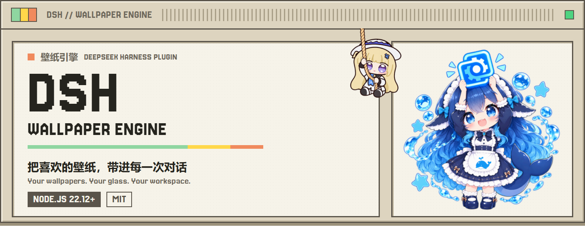

# DSH Wallpaper Engine

[中文](README.md) · **English** · [Beginner guide](README.beginner.md#english)

<picture>
  <source media="(prefers-color-scheme: dark)" srcset="assets/readme/hero-dark.png">
  
</picture>

[](https://nodejs.org) [](LICENSE) [](https://github.com/elysia395/dsh-wallpaper-engine/stargazers) [](https://github.com/elysia395/dsh-wallpaper-engine/forks) [](https://github.com/elysia395/dsh-wallpaper-engine/graphs/contributors) [](https://github.com/elysia395/dsh-wallpaper-engine/releases) [](https://www.npmjs.com/package/dsh-plugin-wallpaper-engine) [](https://www.npmjs.com/package/dsh-plugin-wallpaper-engine) [](https://github.com/PC2005-cloud/dsh-pet/issues/122)

Bring local **Wallpaper Engine Scene, Web and Video wallpapers** into the DSH chat interface, with liquid glass, typography, configuration presets, mascot artwork and optional official dsh-pet integration. The plugin registers no agent tools or prompt text, so it adds no model token overhead.

> **This page describes the unpublished [Fish-under-sea source branch](https://github.com/Fish-under-sea/dsh-wallpaper-engine).** Stars, forks, contributors, releases, npm downloads and Star History refer to the official [elysia395/dsh-wallpaper-engine repository](https://github.com/elysia395/dsh-wallpaper-engine) or its npm package. Cached badges do not mean these branch changes have been merged or published. Identical package version numbers do not guarantee identical source trees.

## Contents

[Features](#features) · [Install](#install) · [Usage](#usage) · [Official dsh-pet integration](#official-dsh-pet-integration) · [Configuration and privacy](#configuration-and-privacy) · [Limitations](#limitations) · [Development](#development) · [Credits](#credits) · [Star History](#star-history)

## Features

| Area | Current capabilities |
|---|---|
| Wallpapers | WebWallGL live Scene / Web rendering, video playback, local image / video uploads, wallpaper properties and playlist rotation |
| Appearance | Liquid glass, accent and surface colors, transparency, blur, borders and independent sidebar controls |
| Presets | Whole-configuration snapshots, optional font / mascot / avatar assets, JSON import and export |
| Typography | System fonts, per-role and per-component controls, terminal fonts, font sets and caret color |
| Mascots | Ten built-in artworks, a 3D ring selector, custom imports and a pull-cord library drawer |
| Extensions | Optional conversation avatars, click / pointer-trail effects and parallax |
| Playback | Speed, flip, framing, transitions, cached fps-cap transcodes and occlusion pause |
| Media | System-output audio spectrum, Now Playing metadata / artwork and opt-in online lyrics |
| Pet integration | Sidebar pull, mascot grab, native knockback and hiss routines using official dsh-pet APIs |

Scene and Web compatibility depends on the project, WebGL support and browser capabilities. Rendering failures degrade rather than guaranteeing parity with every Wallpaper Engine workshop item. **Application wallpapers are not supported**: this plugin does not launch third-party executables. Custom JPG / PNG / MP4 files stay on your machine.

The current suite has **one main package and seven subpackages, eight packages in total**. A local compressed release-set comparison decreased from approximately **84.88 MiB to 25.12 MiB, about 70.4%**, after removing the bundled pet. This excludes the separately installed official pet and is not a memory-use or Git-repository-size measurement.

## Install

### Current test branch: use the complete source installer

Requirements: **Node.js >=22.12.0, a DSH 0.2 kernel (including 0.2.0-rc.1/rc.2), pnpm and the target host's DSH CLI**. The desktop application's external version number is not its kernel version. Optional pet integration needs a separate official pet installation.

1. Download and extract the complete [review branch `official-pet-bridge-20261020`](https://github.com/Fish-under-sea/dsh-wallpaper-engine/tree/official-pet-bridge-20261020), or clone that branch, not the fork's default branch. Open a terminal in the folder containing `package.json`.
2. Completely close the target DSH host. Confirm its actual data directory and profile.
3. Inspect the plan, then run the installer:

```sh
node scripts/install-source.mjs --profile web --dsh-home "<target DSH data directory>" --dry-run
node scripts/install-source.mjs --profile web --dsh-home "<target DSH data directory>" --app-closed
```

For a desktop profile, use `--profile desktop` **with the desktop carrier CLI**. A standalone npm DSH CLI refuses desktop-profile management; changing the profile name does not bypass that protection. If necessary, pass `--dsh-cli "<path to the target CLI lib/bin.js>"`. Do not guess that every host stores its data in `~/.dsh`.

The installer installs source dependencies, builds clients, registers all eight persistent `link:` dependencies and keeps the main bundle as the owner of the plugin rows. Restart the target host afterward. **Keep the source directory in place.** To update, close DSH, update the complete checkout and run the same installer again. Installing only the main package, using a raw `github:` specifier or relying on temporary junctions is not the source deployment procedure.

### npm: only after the complete release set is published

The publisher must build the eight-package set with `npm run pack:release`, publish the seven subpackages first and publish the main package last. The release main manifest declares exact subpackage versions. It does not bundle pet or Electron. A plain root `npm pack` is not a substitute for this complete release set.

Only for an already published complete version:

```sh
dsh plugin --profile web add dsh-plugin-wallpaper-engine
```

This command **does not install unpublished branch changes**. Desktop installations still require the desktop carrier CLI and a fully closed host. See the [deployment and publishing guide](https://github.com/Fish-under-sea/dsh-wallpaper-engine/blob/official-pet-bridge-20261020/CONTRIBUTING.md).

### Rows and platforms

The main, about, mascot / avatar, media bridge, pet integration, effects, parallax and fonts rows are independently managed. Row changes require reload or restart. Disabling the pet row does not disable wallpapers. Do not additionally enable every subpackage bundle: the main patch owns the row set. Media bridge does not yet have exactly the same whole-block UI-hiding semantics as the other components.

Windows, macOS and Linux use the same source suite. On platforms without the Wallpaper Engine client, use local image / video uploads or point custom-wallpaper storage at existing WE project directories. Imported project directories are read-only and are not deleted through upload management.

## Usage

Open **Settings → Wallpaper Engine**, or pull the mascot cord to open the library drawer. Select wallpapers in the **in-panel library**, not a separate modal. Changes apply immediately and persist on the host.


Historical upstream demonstrations may differ from this branch. The six settings tabs are Library, Appearance, Playback, System, Extensions and About.

- **Library**: selection, rating / type filters, soft hiding and restoration, uploads and rotation lists. Hiding never deletes source files. Rotation needs at least two playable candidates and prepares the next item before switching.
- **Appearance**: presets, theme, glass, sidebar corners, global UI colors and typography. Theme-following is **off by default**; a manual theme choice takes precedence for the current wallpaper.
- **Playback**: filters, framing, speed, transitions and audio. Fps-cap transcoding starts with the original and swaps when the cache is ready; unavailable ffmpeg or failed encoding falls back gracefully.
- **System**: mascot selection, adapter target, occlusion pause and cache locations. The default mascot is DeepSeek; Deepseek_Pro and 菲比啾比 are separate artworks, alongside Claude, DeepSeek, Gemini, GPT, GLM, Grok, Kimi and Qwen. The chibi maid is carried by the author preset rather than the built-in carousel.
- **Extensions**: optional avatars, click / trail effects and parallax. Disabling an extension removes its own decorations without resetting the wallpaper.

Glass ownership uses per-surface `auto` / `native` fallback. Unknown plugin surfaces are not forcibly cleared. Extra frost selectors have strict limits and must meet positioning and decoration-safety checks. There is no universal guarantee of compatibility with every skin or plugin. See [coexistence](https://github.com/Fish-under-sea/dsh-wallpaper-engine/blob/official-pet-bridge-20261020/docs/COEXISTENCE.md).

System audio capture uses **output loopback, not the microphone**. Online lyrics are off by default and may send track title, artist and album to LRCLIB when enabled. Media runtime support is native per platform: GSMTC / MediaRemote / MPRIS.

## Official dsh-pet integration

Wallpaper now integrates with the separately installed official [dsh-pet](https://github.com/PC2005-cloud/dsh-pet) through public APIs. Thank you to [PC2005-cloud](https://github.com/PC2005-cloud) for the interfaces and [cross-plugin discussion #122](https://github.com/PC2005-cloud/dsh-pet/issues/122). This is API integration, **not a bundled fork, a third-party file patch or a joint upstream release claim**.

1. Install and enable an official pet build exposing same-page `petApi7340.pose/progress` and HTTP config, lock, anim, position and throw APIs. The `0.3.7` version number alone is insufficient to identify these capabilities.
2. Set the pet to display on the web surface, and set the Wallpaper mascot to official-sidebar mode.
3. Open **Ctrl+Shift+D**, refresh targets, select the intended petId and try the sidebar, mascot-grab, knockback and hiss routines.

| Boundary | Behavior |
|---|---|
| Missing pet / hidden target | Integration stops; wallpaper and the original sidebar action still work. No silent switch to another pet |
| Multiple displays | The same pet's actions follow official shared state across pages / desktop; no instance isolation is promised |
| Bubbles | Drawn by the bridge only in the initiating page; can outlive action ownership; official bubbles are neither occupied nor cleared |
| Tuning | Target selection, four routine pages, timing, stop, reset and JSON export; runtime parameter overrides should be exported before refresh |
| Motion | Uses official position / throw; no pet DOM takeover, private React fields or per-frame HTTP |
| Verification | Protocol, HTTP, playback scheduling and bridge UI checks passed; complete official React-pet and desktop visual acceptance remains outstanding |

Native position interpolation uses wall-clock time and is not guaranteed to track buffered video frame by frame. Existing bundled-pet dependencies, bundle selections, data and earlier external patches are **not automatically removed**. Close the host, disable the old bundled row and follow the [migration and integration guide](packages/pet-link/README.md). The official pet's files, configuration and animation pools are not rewritten.

## Configuration and privacy

Wallpaper settings live in `~/.dsh-wallpaper-engine/config.json`, independent of the browser port. Caches and uploads default to subdirectories under the same data root and can be moved from the UI. Migration moves recognized plugin files, not unrelated files in the target directory. Pet target selection and exported runtime tuning have their separate bridge lifecycle; they are not all part of the host configuration file.

| Variable | Purpose |
|---|---|
| `DSH_WE_DATA_DIR` | Override the whole plugin data root |
| `DSH_WE_CACHE_DIR` / `DSH_WE_UPLOAD_DIR` | Override cache / upload roots |
| `DSH_WE_STEAM_ROOT` / `DSH_WE_ASSETS_DIR` | Override Steam discovery / official WE resources |
| `DSH_WE_FFMPEG` / `DSH_WE_FFMPEG_URL` | Explicit ffmpeg executable / download source |
| `DSH_WE_TRANSCODE_TIMEOUT_MS` | Transcode time budget |
| `DSH_WE_MEDIA_BRIDGE` / `DSH_WE_MEDIA_BRIDGE_URL` | Explicit media bridge / source |
| `DSH_WE_MEDIA_BRIDGE_TAG` / `DSH_WE_MEDIA_BRIDGE_SHA256` | Version and required integrity information for custom versions |
| `DSH_WE_MEDIA_LEGACY` / `DSH_WE_MEDIA_NO_AUDIO` | Built-in fallback / metadata-only mode |
| `DSH_WE_MEDIA_PROVIDER` | `mock` for development |
| `DSH_WE_MEDIA_IDLE_MS` / `DSH_WE_MEDIA_DEBUG` | Idle shutdown / diagnostic output |

Wallpaper files stay local. Runtime downloads, GitHub repository statistics and opt-in lyrics access external services; this is not a claim of fully offline operation.

## Limitations

- Application wallpapers are unsupported. Scene compatibility depends on assets, scripts, WebGL and drivers.
- Three-platform installation does not imply an official Wallpaper Engine client exists on all three platforms.
- Desktop minimize / restore can still expose a brief shell-side white frame; the plugin cannot fully control the host window base plate.
- Video and scene occlusion pause differ from externally hosted iframe behavior. Focus-loss pause is exposed only for the appropriate browser adapter.
- Optional `dsh-better-sidebar` integration has its own surface controls; browsers without backdrop filtering use solid fallback.
- Pet action synchronization and bridge-only bubbles are intentional interface boundaries, not old private-controller parity.

## Development

See the current [contribution guide](https://github.com/Fish-under-sea/dsh-wallpaper-engine/blob/official-pet-bridge-20261020/CONTRIBUTING.md), [changelog](https://github.com/Fish-under-sea/dsh-wallpaper-engine/blob/official-pet-bridge-20261020/docs/CHANGELOG.md), [upgrade notes](https://github.com/Fish-under-sea/dsh-wallpaper-engine/blob/official-pet-bridge-20261020/docs/UPGRADING.md), [rendering design](https://github.com/Fish-under-sea/dsh-wallpaper-engine/blob/official-pet-bridge-20261020/docs/HOW-IT-WORKS.md) and [troubleshooting](https://github.com/Fish-under-sea/dsh-wallpaper-engine/blob/official-pet-bridge-20261020/docs/TROUBLESHOOTING.md). Generated clients are built from source; do not edit generated bundles by hand. The npm package does not ship `docs/`, so these technical links use repository URLs.

Report branch-specific installation or pet-integration problems to the [current fork](https://github.com/Fish-under-sea/dsh-wallpaper-engine/issues), with versions, platform, reproduction steps and sanitized logs. Shared upstream problems belong in the [official tracker](https://github.com/elysia395/dsh-wallpaper-engine/issues). Never include credentials. Community QR codes are available in the [Chinese README](README.md#联系方式).

## Credits

Contributions are grouped by work, not ranked. See the official [Contributors](https://github.com/elysia395/dsh-wallpaper-engine/graphs/contributors) and [merged PRs](https://github.com/elysia395/dsh-wallpaper-engine/pulls?q=is%3Apr+is%3Amerged) for the maintained history.

- **[elysia395](https://github.com/elysia395)**: project creation, upstream maintenance, releases, presets and community.
- **[生鱼 / Fish-under-sea](https://github.com/Fish-under-sea)**: current source-branch integration, whole-configuration presets and asset import / export, mascot carousel, source deployment and release closure, official pet bridge, bubble / routine / tuning work and regression documentation. Earlier work: [#173](https://github.com/elysia395/dsh-wallpaper-engine/pull/173), [#180](https://github.com/elysia395/dsh-wallpaper-engine/pull/180), [integration PR #251](https://github.com/elysia395/dsh-wallpaper-engine/pull/251). Some latest source work remains unpublished.
- **[YV3507](https://github.com/YV3507)**: rendering and frame-pipeline fixes, liquid-glass tokens, architecture, documentation, regression guards and community integration.
- **[oneincase](https://github.com/oneincase)**: [WebWallGL](https://github.com/oneincase/webwallgl), [media-bridge](https://github.com/oneincase/media-bridge), live rendering, cross-platform media and performance work.
- **[yuxilao](https://github.com/yuxilao)** and **[Jerry / ruijiaang-lab](https://github.com/ruijiaang-lab)**: Linux scene-rendering exploration, performance / rotation work, and early macOS / WaifuX compatibility and contribution paths.
- **Community contributors**: WTStarMark, levodoubt, Willhamster, 383891598, SiriLee, libiwolve, 0-007pro, jujubaoj646-star, xiahou001, wilianyichen, hecoococ, ShamSky88, Rekk0, Y1X1n, wwexplorer, jassdingk, w-sli and everyone helping through issues, documentation and device testing. See the [full contribution summary](README.md#致谢).
- **[PC2005-cloud / dsh-pet](https://github.com/PC2005-cloud/dsh-pet)**: official pet APIs and cross-project integration support.
- **Bilibili creator [ZipZipPipe](https://space.bilibili.com/4168597)**: thank you for the **AI-girl fan-character designs used as the basis for our new mascots**. These are fan creations, not official model-vendor characters or endorsements. Attribution does not relicense the artwork under MIT.

The README's retro window layout references [MaiBot](https://github.com/Mai-with-u/MaiBot); Jersey 20 uses SIL OFL 1.1. Source artwork and character rights remain with their respective owners. See [asset sources](assets/readme/SOURCES.md). The code's MIT license does not replace character, image or font permissions. Wallpaper Engine and workshop content belong to their respective owners; this is not an official Wallpaper Engine product.

## Star History

Official upstream history, not fork statistics:

<a href="https://star-history.com/#elysia395/dsh-wallpaper-engine&Date">
  <picture>
    <source media="(prefers-color-scheme: dark)" srcset="https://api.star-history.com/svg?repos=elysia395/dsh-wallpaper-engine&amp;type=Date&amp;theme=dark">
    
  </picture>
</a>
